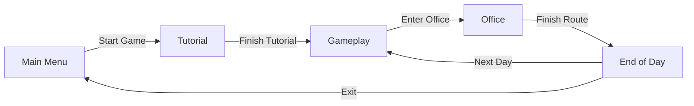
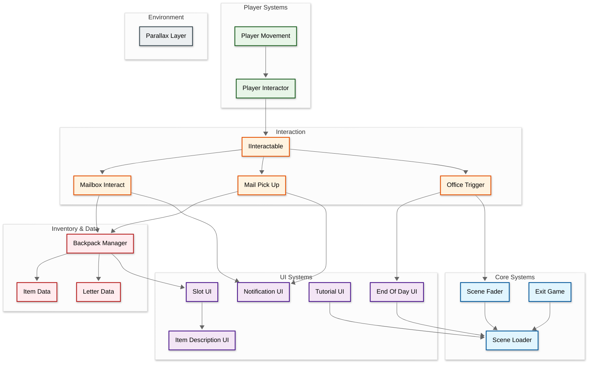
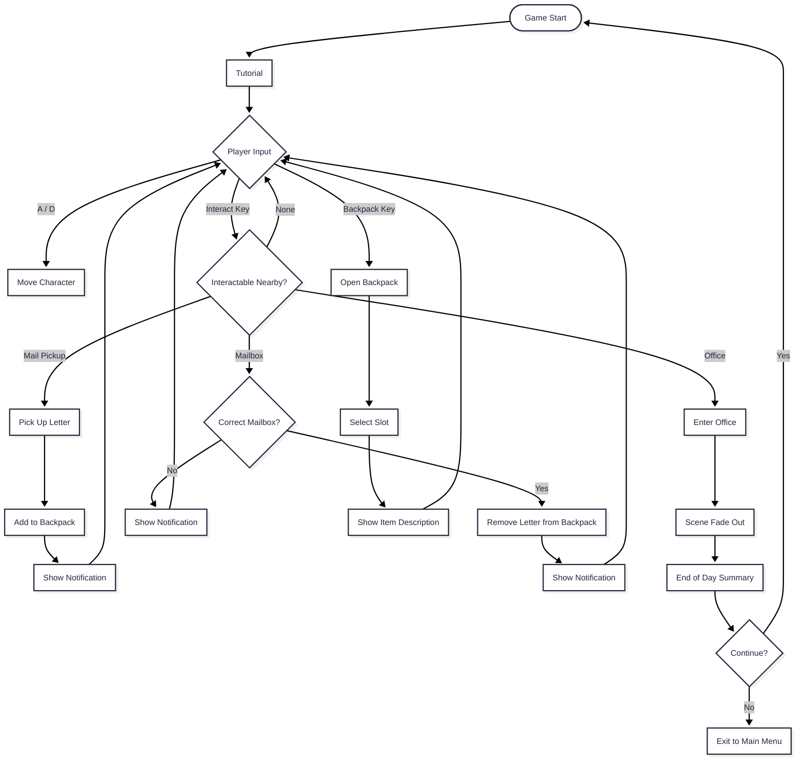

## Developer & Contributions
Peace Anya (Game Designer)  
Jevon (Game Programmer)  
Jason (Game Programmer)  
Sambalcapcay (Game Artist)

## About
**[Game Title]** is a 2D narrative delivery game where players take on the role of a mail carrier. Walk through the world, pick up letters, manage what you carry in your backpack, and deliver each piece of mail to the right mailbox. Return to the office when the day is over and see how you did. Every letter has its own details, so paying attention to who it's for matters.

 

## Key Features

**Mail Delivery Loop**: Pick up letters around the world, carry them in your backpack, and drop them off at the correct mailboxes before the day ends.

**Backpack & Inventory System**: Manage collected items and letters in a slot-based backpack, with item descriptions you can inspect to understand what you're carrying.

**Interaction System**: A flexible interaction system lets the player interact with mailboxes, mail pickups, and the office through one shared interface.

**Day Structure & Feedback**: Notifications keep you informed during play, the office marks the end of your route, and an end-of-day screen wraps up each shift. A tutorial helps new players learn the ropes.

**Atmospheric Visuals**: Parallax scrolling backgrounds and smooth scene fades give the world depth and polish.

<table>
<tr>
<td align="center" width="50%">
<strong>Mail Pickup & Backpack</strong> 
Collect letters and manage your backpack

</td>
<td align="center" width="50%">
<strong>Mailbox Delivery</strong> 
Deliver letters to the right mailbox

</td>
</tr>
</table>

## Scene Flow

## Layer / Module Design

## Modules and Features

The delivery gameplay, backpack inventory, interaction system, and UI are powered by a modular Unity C# scripting system.

| 📂 Name | 🎬 Scene | 📋 Responsibility |
|---------|----------|-------------------|
| **PlayerMovement** | **Gameplay** | - Handle player movement input - Control speed and facing direction - Support animation states |
| **PlayerInteractor** | **Gameplay** | - Detect nearby interactable objects - Trigger interaction on player input - Work with any object that implements IInteractable |
| **IInteractable** | **Gameplay** | - Interface for interactable objects - Let mailboxes, pickups, and the office share one interaction flow |
| **MailPickUp** | **Gameplay** | - Let the player collect letters from the world - Add picked up mail to the backpack - Trigger pickup notifications |
| **MailboxInteract** | **Gameplay** | - Handle delivering letters to mailboxes - Check the letter against the mailbox - Remove delivered letters from the backpack |
| **OfficeTrigger** | **Gameplay** | - Detect when the player reaches the office - Start the end of day sequence |
| **BackpackManager** | **Gameplay** | - Store and manage collected items and letters - Add and remove items - Keep the backpack UI in sync |
| **ItemData** | **Data** | - Define item properties such as name, icon, and description |
| **LetterData** | **Data** | - Define letter properties such as sender, recipient, and contents |
| **SlotUI** | **Gameplay** | - Display a single backpack slot - Show item icon and handle selection |
| **ItemDescriptionUI** | **Gameplay** | - Show details of the selected item or letter |
| **NotificationUI** | **Gameplay** | - Display short messages to the player - Give feedback on pickups and deliveries |
| **TutorialUI** | **Tutorial** | - Guide new players through the controls and delivery loop |
| **EndOfDayUI** | **End of Day** | - Show the end of day summary - Handle continue and exit options |
| **SceneLoader** | **All Scenes** | - Load and switch between scenes |
| **SceneFader** | **All Scenes** | - Fade the screen in and out - Provide smooth scene transitions |
| **ExitGame** | **Main Menu** | - Quit the application |
| **ParallaxLayer** | **Gameplay** | - Scroll background layers at different speeds - Create depth in the scene |

 

## Game Flow Chart

 

## Play The Game
<a href="https://exaltedartix.itch.io/wordbearer">Play Now</a>

 

## Installation & Setup
1. Clone this repository
2. Open the project in Unity (version used in your project recommended)
3. Open the main menu scene
4. Press Play to start testing

## Controls
- **A / D or Arrow Keys** - Movement
- **E** - Interact (pick up mail, deliver to mailbox, enter office)
- **Backpack Key** - Open or close the backpack
- **Escape** - Pause / Exit

## Credits
Game developed as a personal project by team.

- Engine : Unity
- Assets : Clip Studio Paint & Free assets itch.io
